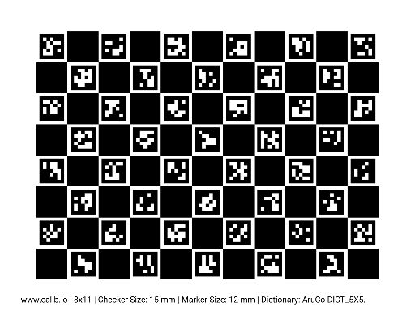
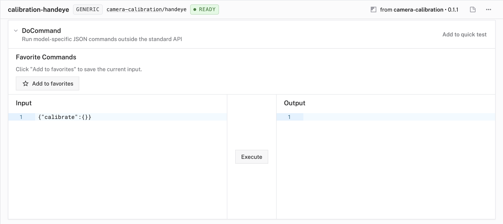
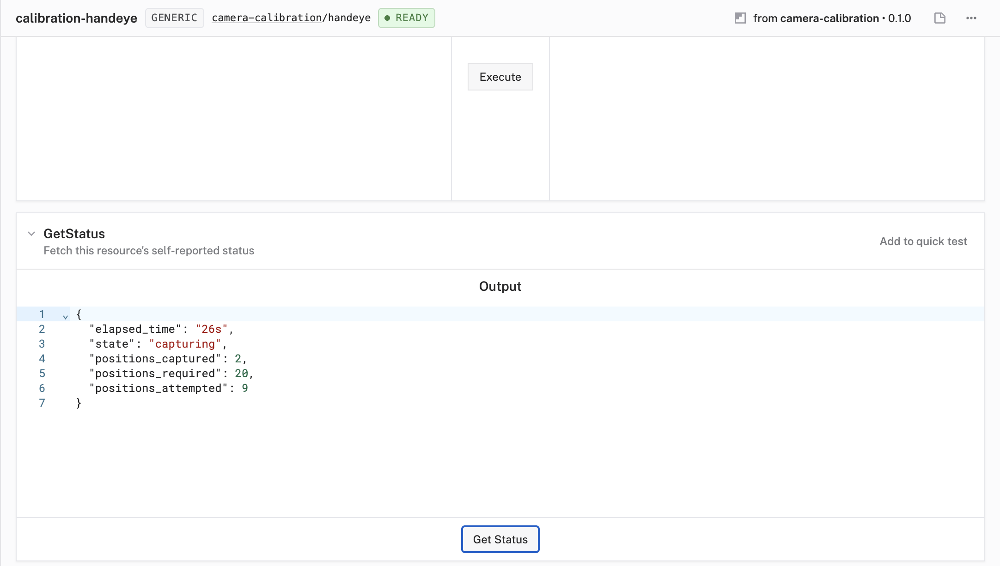
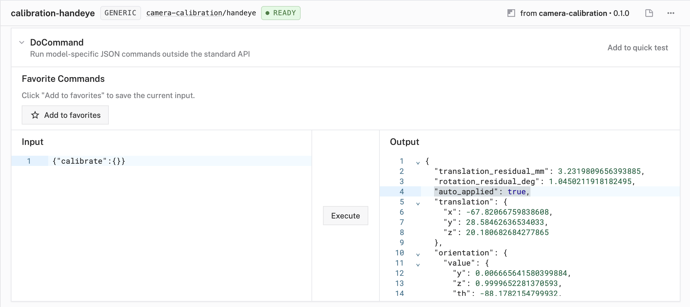

# camera-calibration

Frame calibration for cameras via arms. This module's purpose is to help you calibrate as fast as possible.

## How It Works

The module figures out where your camera sits relative to the arm by moving the arm to ~20 positions, photographing a board from each one, and solving for the transform. On success, it writes the calibrated frame back to your camera's config automatically.

## Quick Start

### Step 1: Get a calibration board

We suggest a ChArUco board. The specific board we validate against: [Calib.io ChArUco 300x200x6 mm, Coarse pattern, Aluminium/LDPE](https://calib.io/products/charuco-targets?variant=9400454807599).



### Step 2: Add the module

```json
{
  "type": "registry",
  "name": "viam_camera-calibration",
  "module_id": "viam:camera-calibration",
  "version": "latest"
}
```

### Step 3: Configure the pose_tracker

Values below match the recommended board from Step 1. **Replace `camera` with your camera's name.** For a different board, replace `squares_x`, `squares_y`, `square_length_mm`, and `marker_length_mm` with values from your board's spec sheet.

```json
{
  "name": "calibration-charuco",
  "api": "rdk:component:pose_tracker",
  "model": "viam:camera-calibration:charuco",
  "attributes": {
    "camera": "your-camera-name",
    "dictionary": "DICT_5X5_100",
    "squares_x": 14,
    "squares_y": 9,
    "square_length_mm": 20,
    "marker_length_mm": 15
  }
}
```

### Step 4: Configure the calibration service

Pick the one that matches your physical setup.

#### Camera mounted on arm

The camera's `frame.parent` should be the arm.

```json
{
  "name": "calibration-handeye",
  "api": "rdk:service:generic",
  "model": "viam:camera-calibration:eye_in_hand",
  "attributes": {
    "arm": "your-arm-name",
    "pose_tracker": "calibration-charuco"
  }
}
```

#### Camera not mounted on arm

The camera's `frame.parent` should be `world` (or `<arm>_origin`), not the arm.

```json
{
  "name": "calibration-handeye",
  "api": "rdk:service:generic",
  "model": "viam:camera-calibration:eye_to_hand",
  "attributes": {
    "arm": "your-arm-name",
    "pose_tracker": "calibration-charuco"
  }
}
```

**Strongly recommended**: set `input_range_override` to tighten joint limits to the subset your rig can safely sweep. Without it the arm may whip cables or hit things. See the reference table below.

### Step 5: Position the arm

Manually move the arm so the camera has a clean, close view of the whole board. Board should fill 40-70% of the frame, all corners visible. This becomes the starting pose — the arm returns here after calibrating.

### Step 6: Run calibrate

> **THIS STEP WILL MOVE THE ARM**

From the app's Control tab, on `calibration-handeye`, send:

```json
{"calibrate": {}}
```



Takes a few minutes. Call `Status` on `calibration-handeye` to watch progress.



On success, **your camera's `frame` block in the machine config is updated automatically** — verify by checking `"auto_applied": true` in the response.



If `auto_applied: false`, the calibration ran but a quality gate wasn't met. The result is still returned; inspect the `quality` block to decide whether to apply the returned `frame` manually or re-run.

## Reference

### `viam:camera-calibration:charuco`

| Field              | Required | Default         | Description                                                                              |
| ------------------ | -------- | --------------- | ---------------------------------------------------------------------------------------- |
| `camera`           | Yes      | —               | Name of the camera to detect on.                                                         |
| `dictionary`       | Yes      | —               | ArUco dictionary. `DICT_{4,5,6,7}X{4,5,6,7}_{50,100,250,1000}` or `DICT_ARUCO_ORIGINAL`. |
| `squares_x`        | Yes      | —               | Board width in squares.                                                                  |
| `squares_y`        | Yes      | —               | Board height in squares.                                                                 |
| `square_length_mm` | Yes      | —               | Physical square edge length in mm.                                                       |
| `marker_length_mm` | Yes      | —               | Physical marker edge length in mm (< `square_length_mm`).                                |
| `image_source`     | No       | first available | Stream to pull from a multi-stream camera (e.g. `"color"` on RGB+depth).                 |
| `distortion`       | No       | from camera     | Override the camera's distortion coefficients (see note below).                          |

> **On `distortion`**: for cameras that undistort on-device (e.g. Zivid, Ensenso, Orbbec), set to `[0, 0, 0, 0, 0]`. For cameras that publish real distortion coefficients (e.g. Realsense), leave unset.

### `viam:camera-calibration:eye_in_hand` and `viam:camera-calibration:eye_to_hand`

Both models take the same attributes.

| Field                         | Required | Default | Description                                                                   |
| ----------------------------- | -------- | ------- | ----------------------------------------------------------------------------- |
| `arm`                         | Yes      | —       | Name of the arm.                                                              |
| `pose_tracker`                | Yes      | —       | Name of the pose_tracker (usually the charuco above).                         |
| `num_poses`                   | No       | 20      | Successful captures required before solving.                                  |
| `workspace_bounds`            | No       | auto    | Sample region for calibration poses. Auto-derived from the board position if omitted. |
| `settle_seconds`              | No       | 2.0     | Delay after each arm move before capturing.                                   |
| `input_range_override`        | No       | —       | Tighten arm joint limits (radians). Keys are joint indices (`"0"`, `"1"`, ...) or joint names; values are `{"Min": ..., "Max": ...}`. Applied to the arm named in `arm`. |
| `auto_apply_result`           | No       | `true`  | Write the calibrated frame back to the camera's config. Set to `false` to skip the write and inspect the result manually. |
| `target_camera`               | No       | derived | Override which camera's `frame` block gets updated.                           |
| `max_translation_residual_mm` | No       | 5.0     | Skip auto-apply if solve residual exceeds this.                               |
| `max_rotation_residual_deg`   | No       | 2.0     | Skip auto-apply if solve residual exceeds this.                               |
| `min_pose_diversity_deg`      | No       | 30.0    | Skip auto-apply if mean pairwise arm-rotation angle across stations is below this — the solve is mathematically underdetermined regardless of how good residuals look. |
| `max_reprojection_error_px`   | No       | 2.0     | Skip auto-apply if the mean per-station board-corner reprojection error exceeds this. Sub-pixel is expected for good detections; large values usually mean wrong intrinsics, wrong distortion, or bad focus. |
| `max_consecutive_failures`    | No       | 200     | Bail out of the sweep if this many attempts in a row fail (unreachable pose, board not detected). Any successful capture resets the counter. |
| `save_slow_plan_threshold_ms` | No       | 1500    | If a plan's planning duration exceeds this (in ms), save the `PlanRequest` to the capture dir for offline debugging. |
| `save_all_plans`              | No       | `false` | If `true`, save every `PlanRequest` to the capture dir regardless of speed. Supersedes `save_slow_plan_threshold_ms`. |

### DoCommands

`calibrate` — runs the full pipeline; takes a few minutes; returns:

```json
{
  "frame": {
    "parent": "your-arm-name",
    "translation": {"x": -37.6, "y": -75.2, "z": 109.5},
    "orientation": {"type": "ov_degrees", "value": {"x": 0.002, "y": 0.002, "z": 1.0, "th": 1.16}}
  },
  "quality": {
    "status": "success",
    "failed_gates": [],
    "translation_residual_mm": 0.94,
    "rotation_residual_deg": 0.34,
    "pose_diversity_deg": 96.5,
    "mean_station_reprojection_px": 0.52,
    "max_station_reprojection_px": 0.80
  },
  "auto_applied": true
}
```

`quality.status` is `"success"` when every gate passed, `"failed"` otherwise. `quality.failed_gates` lists which ones tripped (`translation_residual`, `rotation_residual`, `pose_diversity`, `mean_reprojection`).

The `frame` block matches the schema of a camera's `frame` config, so if `auto_applied: false` you can copy it straight into the camera's config.

`cancel` — halts a running calibrate.

```json
{"cancel": {}}
```

`Status` (standard RDK, not DoCommand) — poll from a second client during a run:

```json
{
  "state": "capturing",
  "positions_captured": 6,
  "positions_required": 20,
  "positions_attempted": 8,
  "elapsed_time": "1m 12s"
}
```

States: `ready | capturing | solving | applying | complete | failed`.

## Troubleshooting

- **Nonsense reprojection error on Realsense or Orbbec cameras**: set `"image_source": "color"` on the charuco tracker attributes. Without it, the module may grab the depth stream by default, producing garbage detections.
- **Execution failure during a sweep**: the failing plan request, trajectory, and arm position are saved to the machine's capture dir under `tag=camera-calibration-<timestamp>/` for offline debugging.

## Not Supported

- **Cameras defined via fragments**: auto-apply can't write the calibrated frame back into a fragment-owned camera. Set `auto_apply_result: false` and copy the returned transform into the fragment's camera config manually.
